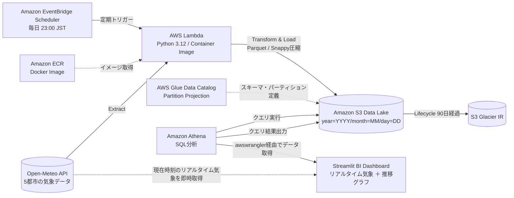

# 天気データの自動取得・データ格納・BIダッシュボード（aws-weather-etl）

**「毎日の天気データを自動で集めて、クラウドに綺麗に整理し、グラフで見える化する」** ための自動化システムです。

これまで手動で調べてExcelにまとめるような作業を **完全自動化** し、サーバーの管理も不要（サーバーレス）なため、**月額ほぼ無料（数円〜数十円レベル）** で24時間365日動き続けます。

---

## 🎯 このシステムでできること（3つのポイント）

1. **毎日決まった時間に自動でデータ収集**
   - 毎日23時に、日本主要5都市（札幌・東京・大阪・松山・福岡）の気象データを自動で取得して保存します。
2. **「今この瞬間の天気」と「過去の推移」を1つの画面で確認**
   - Web画面を開くと、**「今現在のリアルタイムの天気・気温」**と**「これまでの最高・最低気温の推移グラフ」**がひと目でわかります。

3. **コマンド1つで誰でも構築・起動できる**
   - 複雑な画面操作や設定作業をなくし、プログラムを1つ実行するだけでクラウド環境の構築から画面表示まで完結します。

---

## 🏗 アーキテクチャ構成図



---

## 💡 技術選定と設計のポイント（AWS設計ベストプラクティス）

データエンジニアリングおよびクラウドアーキテクチャの観点から、以下の設計を採用しています。

1. **列指向フォーマット（Parquet + Snappy圧縮）の採用**
   - `pandas` と `pyarrow` を用いて JSON データを Apache Parquet 形式へ変換し、スキャンデータ量の削減と Athena クエリの高速化・コスト最適化を実現しました。
2. **コンテナイメージ形式の AWS Lambda**
   - `pandas` / `pyarrow` などの重いデータ処理ライブラリを安定してパッケージングするため、Amazon ECR を用いたコンテナベース Lambda（Python 3.12）を採用しています。
   - ECR のライフサイクルポリシーにより最新3世代のイメージのみを保持し、ストレージコストを抑制しています。
3. **Partition Projection による運用レス・低コスト設計**
   - S3 キーを Hive 形式（`raw/weather_daily/year=YYYY/month=MM/day=DD/`）でパーティショニングしつつ、Glue Data Catalog テーブルに **Partition Projection** を設定しました。
   - AWS Glue Crawler の定期実行コストや `MSCK REPAIR TABLE` の運用なしで、新規追加された日付のデータを即座にクエリ可能です。
4. **冪等性（Idempotency）とストレージ階層化**
   - 日付単位の決定論的な S3 キー名で出力することで、パイプライン再実行時にもデータ重複が発生しない冪等性を担保しています。
   - S3 ライフサイクルルールを設定し、90日経過した生データは自動的に `GLACIER_IR`（Glacier Instant Retrieval）へ移行させています。
5. **セキュリティと最小権限の原則（IAM）**
   - Lambda 実行ロールには対象 S3 バケットの `raw/*` プレフィックスへの `PutObject` と CloudWatch Logs 出力のみを許可しています。
   - S3 バケットのパブリックアクセス全ブロック、SSE-S3 暗号化、および Athena ワークグループ側での暗号化強制を有効化しています。
6. **リアルタイム＆バッチのハイブリッド可視化（Streamlit）**
   - ダッシュボード表示時に Open-Meteo API から現在時刻の最新気象を即時取得して表示しつつ、Athena に蓄積された日次履歴データの推移グラフもあわせて確認できます。

---

## 🛠 使用技術スタック

| カテゴリ | 技術・サービス | 用途 |
| :--- | :--- | :--- |
| **IaC** | Terraform | AWSリソース全体のプロビジョニング |
| **Compute / Container** | AWS Lambda, Amazon ECR, Docker | サーバーレスETL処理の実行環境 |
| **Language / Library** | Python 3.12, pandas, pyarrow, boto3, requests | データ取得・Parquet変換・S3アップロード |
| **Orchestration** | Amazon EventBridge Scheduler | タイムゾーン指定（`Asia/Tokyo`）での定期実行 |
| **Storage** | Amazon S3 | パーティション構成データレイク・クエリ結果保存 |
| **Data Catalog / Query** | AWS Glue Data Catalog, Amazon Athena | メタデータ管理・サーバーレスSQL分析 |
| **BI / Visualization** | Streamlit, awswrangler, Plotly | Athenaデータ取得・リアルタイム気象可視化 |
| **External API** | Open-Meteo Forecast API | 日本5都市の気象データ取得（APIキー不要） |

---

## 📂 ディレクトリ構成

```text
aws-weather-etl/
├── README.md
├── .gitignore
├── deploy.sh                  # AWSインフラ・コンテナ一括デプロイスクリプト
├── run_dashboard.sh           # Streamlitダッシュボードワンコマンド起動スクリプト
├── src/
│   ├── Dockerfile             # public.ecr.aws/lambda/python:3.12 ベース
│   ├── requirements.txt       # Lambda用Python依存ライブラリ
│   └── handler.py             # ETL処理本体（Extract / Transform / Load）
├── terraform/
│   ├── main.tf                # Provider設定
│   ├── variables.tf           # 変数定義
│   ├── ecr.tf                 # ECRリポジトリ・ライフサイクルポリシー
│   ├── s3.tf                  # S3バケット・暗号化・ライフサイクル設定
│   ├── iam.tf                 # Lambda最小権限IAMロール・ポリシー
│   ├── lambda.tf              # Lambda関数・CloudWatch Logs設定
│   ├── eventbridge.tf         # EventBridge Scheduler設定
│   ├── athena.tf              # Glue Data Catalog・Athena Workgroup設定
│   └── outputs.tf             # 出力値定義
└── dashboard/
    ├── app.py                 # Streamlit BIダッシュボード本体
    └── requirements.txt       # ダッシュボード用Python依存ライブラリ
```

---

## 🚀 デプロイ手順

前提条件（AWS CLI / Terraform / Docker）が整った状態で、以下のスクリプトを実行すると ECR 作成・イメージプッシュ・全インフラ構築が一括で完了します。

```bash
./deploy.sh
```

---

## 📈 BIダッシュボードの起動手順

以下のスクリプトを実行し、ブラウザで `http://localhost:8501` にアクセスするとダッシュボードが表示されます（初回は仮想環境とライブラリが自動セットアップされます）。

```bash
./run_dashboard.sh
```
