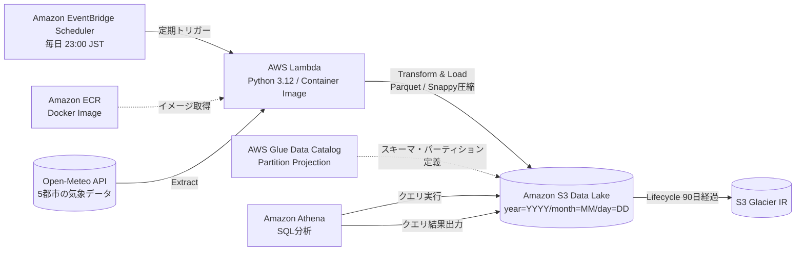

# AWS Serverless Weather Data ETL Pipeline (`aws-weather-etl`)

日本主要5都市（札幌・東京・大阪・松山・福岡）の日次気象データを外部APIから自動収集し、分析最適化された **Apache Parquet** 形式で Amazon S3 データレイクへ蓄積、Amazon Athena で即座に SQL 分析できるサーバーレス ETL パイプラインです。

インフラ構築からデータカタログ定義まで、すべて **Terraform (IaC)** でコード化しています。

---

## 🏗 アーキテクチャ構成図



---

## 💡 技術選定と設計のポイント（AWS設計ベストプラクティス）

データエンジニアリングおよびクラウドアーキテクチャの観点から、以下の設計を採用しています。

1. **列指向フォーマット（Parquet + Snappy圧縮）の採用**
   - `pandas` と `pyarrow` を用いて JSON データを Apache Parquet 形式へ変換し、スキャンデータ量の削減と Athena クエリの高速化・コスト最適化を実現しました。
2. **コンテナイメージ形式の AWS Lambda**
   - `pandas` / `pyarrow` などの重いデータ処理ライブラリを安定してパッケージングするため、Amazon ECR を用いたコンテナベース Lambda（Python 3.12）を採用しています。
   - ECR のライフサイクルポリシーにより最新3世代のイメージのみを保持し、ストレージコストを抑制しています。
3. **Partition Projection による運用レス・低コスト設計**
   - S3 キーを Hive 形式（`raw/weather_daily/year=YYYY/month=MM/day=DD/`）でパーティショニングしつつ、Glue Data Catalog テーブルに **Partition Projection** を設定しました。
   - これにより、AWS Glue Crawler の定期実行コストや `MSCK REPAIR TABLE` の運用なしで、新規追加された日付のデータを即座にクエリ可能です。
4. **冪等性（Idempotency）とストレージ階層化**
   - 日付単位の決定論的な S3 キー名で出力することで、パイプライン再実行時にもデータ重複が発生しない冪等性を担保しています。
   - S3 ライフサイクルルールを設定し、90日経過した生データは自動的に `GLACIER_IR`（Glacier Instant Retrieval）へ移行させています。
5. **セキュリティと最小権限の原則（IAM）**
   - Lambda 実行ロールには対象 S3 バケットの `raw/*` プレフィックスへの `PutObject` と CloudWatch Logs 出力のみを許可しています。
   - S3 バケットのパブリックアクセス全ブロック、SSE-S3 暗号化、および Athena ワークグループ側での暗号化強制を有効化しています。

---

## 🛠 使用技術スタック

| カテゴリ | 技術・サービス | 用途 |
| :--- | :--- | :--- |
| **IaC** | Terraform | AWSリソース全体のプロビジョニング |
| **Compute / Container** | AWS Lambda, Amazon ECR, Docker | サーバーレスETL処理の実行環境 |
| **Language / Library** | Python 3.12, pandas, pyarrow, boto3, requests | データ取得・Parquet変換・S3アップロード |
| **Orchestration** | Amazon EventBridge Scheduler | タイムゾーン指定（`Asia/Tokyo`）での定期実行 |
| **Storage** | Amazon S3 | パーティション構成データレイク・クエリ結果保存 |
| **Data Catalog / Query** | AWS Glue Data Catalog, Amazon Athena | メタデータ管理・サーバーレスSQL分析 |
| **External API** | Open-Meteo Forecast API | 日本5都市の気象データ取得（APIキー不要） |

---

## 📂 ディレクトリ構成

```text
aws-weather-etl/
├── README.md
├── .gitignore
├── src/
│   ├── Dockerfile             # public.ecr.aws/lambda/python:3.12 ベース
│   ├── requirements.txt       # Python依存ライブラリ
│   └── handler.py             # ETL処理本体（Extract / Transform / Load）
└── terraform/
    ├── main.tf                # Provider設定
    ├── variables.tf           # 変数定義
    ├── ecr.tf                 # ECRリポジトリ・ライフサイクルポリシー
    ├── s3.tf                  # S3バケット・暗号化・ライフサイクル設定
    ├── iam.tf                 # Lambda最小権限IAMロール・ポリシー
    ├── lambda.tf              # Lambda関数・CloudWatch Logs設定
    ├── eventbridge.tf         # EventBridge Scheduler設定
    ├── athena.tf              # Glue Data Catalog・Athena Workgroup設定
    └── outputs.tf             # 出力値定義
```

---

## 📊 Amazon Athena 分析クエリ例

5都市の最高・最低気温の比較、日較差（寒暖差）、および経度差による日の出・日の入り時刻の違いを分析するクエリ例です。

```sql
SELECT
  date,
  city,
  weather_desc,
  temp_max,
  temp_min,
  ROUND(temp_max - temp_min, 1) AS temp_diff,
  substr(sunrise, 12, 5) AS sunrise_time,
  substr(sunset, 12, 5) AS sunset_time
FROM weather_pipeline_db.weather_daily
WHERE year = '2026' AND month = '11' AND day = '25'
ORDER BY temp_max DESC;
```

---

## 🚀 デプロイ手順

### 前提条件
- AWS CLI（認証設定済み）
- Terraform (`>= 1.5`)
- Docker

### 1. ECRリポジトリの先行作成
```bash
cd terraform
terraform init
terraform apply -target=aws_ecr_repository.lambda_repo
```

### 2. コンテナイメージのビルド & ECR へのプッシュ
※ Lambda 互換の単一アーキテクチャマニフェストを生成するため `--provenance=false` を指定します。
```bash
AWS_ACCOUNT_ID=\$(aws sts get-caller-identity --query Account --output text)
REGION="ap-northeast-1"
REPO_URI="\({AWS_ACCOUNT_ID}.dkr.ecr.\){REGION}://"

aws ecr get-login-password --region \${REGION} | docker login --username AWS --password-stdin \({AWS_ACCOUNT_ID}.dkr.ecr.\){REGION}.amazonaws.com

cd ../src
docker build --provenance=false -t weather-pipeline-lambda:latest .
docker tag weather-pipeline-lambda:latest \${REPO_URI}:latest
docker push \${REPO_URI}:latest
```

### 3. 全AWSリソースのデプロイ
```bash
cd ../terraform
terraform apply
```
